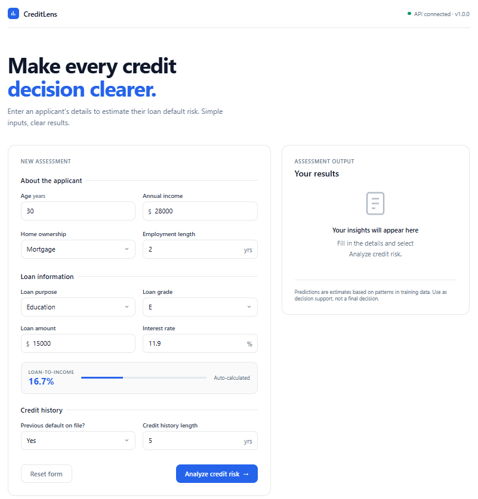
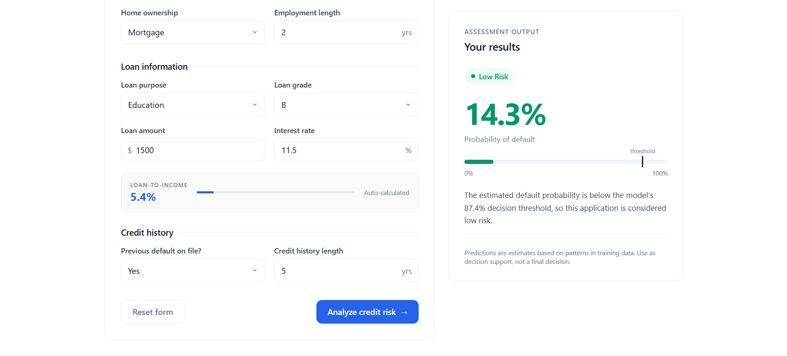
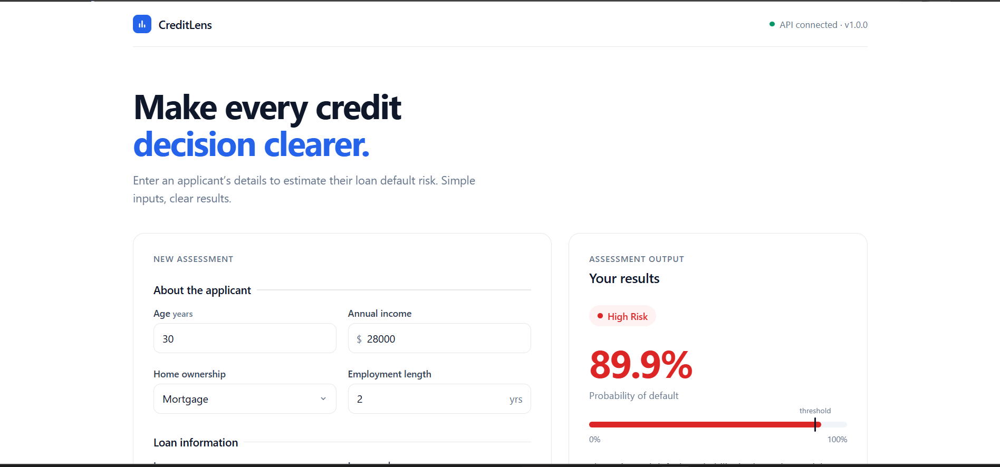

# CreditLens — Credit Risk Analyzer

An end-to-end machine learning app that estimates a loan applicant's risk of default. An XGBoost model is served by a FastAPI backend, with a clean web interface on top.

**🔗 Live demo:** https://credit-risk-analyzer-p1ib.onrender.com/
*(Hosted on a free instance — the first load may take ~30 seconds to wake up.)*



## Features
- Enter applicant details and loan terms, get a **High Risk / Low Risk** decision with a risk score
- Decision made with a **tuned threshold** (not the default 0.5) selected on validation data
- Input validation with Pydantic (types, ranges, allowed categories)
- Loan-to-income ratio calculated automatically
- REST API with interactive docs at `/docs` and a `/health` endpoint
- Containerized with Docker, deployed on Render

| Low Risk example | High Risk example |
|---|---|
|  |  |

## Model
- **Algorithm:** XGBoost classifier inside a scikit-learn pipeline
- **Data:** Credit Risk Dataset (loan applicants, ~32k rows), target `loan_status`
- **Inputs:** age, income, home ownership, employment length, loan purpose, loan grade, loan amount, interest rate, previous default, credit history length, loan-to-income ratio
- **Decision threshold:** tuned and stored in `model/best_threshold`

## Tech stack
Python · XGBoost · scikit-learn · pandas · FastAPI · Pydantic · Uvicorn · HTML/CSS/JavaScript · Docker · Render

## API
```bash
curl -X POST https://YOUR-APP-NAME.onrender.com/predict \
  -H "Content-Type: application/json" \
  -d '{
    "person_age": 24, "person_income": 28000,
    "person_home_ownership": "RENT", "person_emp_length": 1,
    "loan_intent": "MEDICAL", "loan_grade": "E",
    "loan_amnt": 15000, "loan_int_rate": 15.5,
    "cb_person_default_on_file": "Y", "cb_person_cred_hist_length": 2
  }'
```
Response:
```json
{"default_probability": 0.88, "default_prediction": 1, "threshold": 0.874, "Result": "High Risk"}
```

## Run locally
```bash
git clone https://github.com/SyrnaxX/credit-risk-analyzer.git
cd credit-risk-analyzer
python -m venv .venv && source .venv/bin/activate   # Windows: .venv\Scripts\activate
pip install -r requirements.txt
uvicorn main:app --reload
```
Open http://127.0.0.1:8000

With Docker:
```bash
docker build -t credit-risk-analyzer .
docker run -p 8000:8000 -e PORT=8000 credit-risk-analyzer
```

## Project structure
```
├── main.py            # FastAPI app (API + serves the frontend)
├── model/             # predict.py, trained model, threshold, notebook
├── schema/            # Pydantic input validation
├── frontend/          # index.html (UI)
├── docs/images/       # screenshots and charts
├── Dockerfile
└── requirements.txt
```

## Disclaimer
This is a portfolio project. Predictions are estimates based on patterns in historical data and should not be used for real lending decisions.
